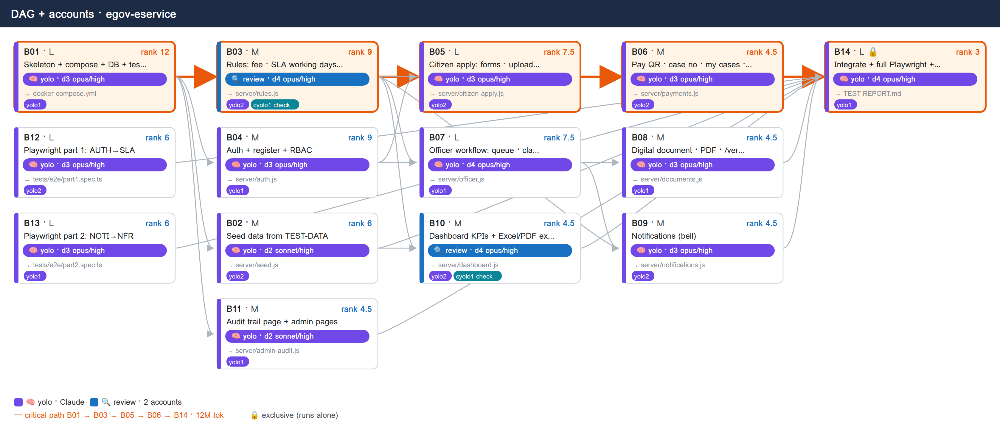
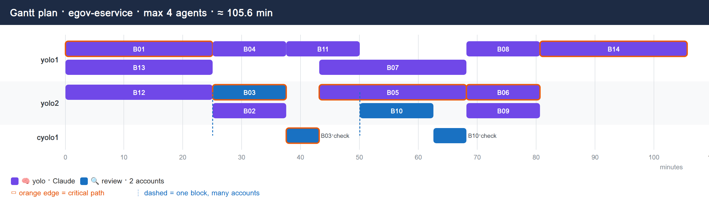

# PLAN · egov-eservice

**Goal:** Central e-Service web for a fictional city, built to /workspace/egov-brief (REQUIREMENTS CONTRACT TEST-DATA DECISIONS), Docker Compose one command, TEST_MODE=1 + BUG_MODE per BUGS.md, Playwright for all 51 TC in TEST-PLAN

Made 2026-11-16 17:39 · max agents 4 · quota: real quota (team.py quota) · time factor k: none yet (k = 1)

> Plan only. Nothing ran. KC-QUEST picked accounts from quota and simulated the timing.

## 1. Accounts

| account | 5 h used | week used | week resets in (h) | slots | source |
| --- | --- | --- | --- | --- | --- |
| yolo1 | 53% | 58% | 7.3 | 4 | real |
| yolo2 | 53% | 58% | 7.3 | 4 | real |
| cyolo1 | 10% | 2% | 163.8 | 3 | real |

## 2. DAG

**Critical path:** B01 → B03 → B05 → B06 → B14 · 12M tok

## 3. Who does what, when

| block | skill | title | size · M tok | waits for | rank | accounts (role) | start–end min | KC-QUEST reason |
| --- | --- | --- | --- | --- | --- | --- | --- | --- |
| B01 | yolo | Skeleton + compose + DB + test hooks | L · 3 | – | 12 | yolo1 (do) | 0.0–25.0 | yolo1 52.0 (U=0.766 F=0.023 R=0.392 V=1.0 L=0.0) · cap 51.37M · 5h 7.8% / week 0.98% · 2nd yolo2 52.0 |
| B02 | yolo | Seed data from TEST-DATA | M · 1.5 | B01 | 6 | yolo2 (do) | 25.0–37.5 | yolo2 40.6 (U=0.766 F=0.012 R=0.314 V=0.5 L=0.25) · cap 10.81M · 5h 3.9% / week 0.49% · 2nd yolo1 39.4 |
| B03 | review | Rules: fee · SLA working days · levels | M · 1.5 | B01 | 9 | yolo2 (do), cyolo1 (check) | 25.0–43.1 | yolo2 47.4 (U=0.766 F=0.012 R=0.353 V=0.75 L=0.0) · cap 13.69M · 5h 3.9% / week 0.49% · 2nd yolo1 46.3 · cyolo1 26.3 (U=0.128 F=0.001 R=0.888 V=0.525 L=0.0) · cap 41.39M · 5h 1.17% / week 0.15% |
| B04 | yolo | Auth + register + RBAC | M · 1.5 | B01 | 9 | yolo1 (do) | 25.0–37.5 | yolo1 46.3 (U=0.766 F=0.012 R=0.275 V=0.75 L=0.0) · cap 10.69M · 5h 3.9% / week 0.49% · 2nd yolo2 44.3 |
| B05 | yolo | Citizen apply: forms · upload · drafts | L · 3 | B03, B04 | 7.5 | yolo2 (do) | 43.1–68.1 | yolo2 44.0 (U=0.766 F=0.024 R=0.236 V=0.625 L=0.0) · cap 10.69M · 5h 7.8% / week 0.98% · 2nd yolo1 40.4 |
| B06 | yolo | Pay QR · case no · my cases · cancel · resubmit | M · 1.5 | B03, B05 | 4.5 | yolo2 (do) | 68.1–80.6 | yolo2 38.9 (U=0.766 F=0.013 R=0.158 V=0.375 L=0.0) · cap 6.19M · 5h 3.9% / week 0.49% · 2nd yolo1 38.3 |
| B07 | yolo | Officer workflow: queue · claim · return · route · approve | L · 3 | B03, B04 | 7.5 | yolo1 (do) | 43.1–68.1 | yolo1 40.4 (U=0.766 F=0.025 R=0.158 V=0.625 L=0.25) · cap 6.31M · 5h 7.8% / week 0.98% · 2nd yolo2 40.4 |
| B08 | yolo | Digital document · PDF · /verify | M · 1.5 | B07 | 4.5 | yolo1 (do) | 68.1–80.6 | yolo1 38.3 (U=0.766 F=0.013 R=0.119 V=0.375 L=0.0) · cap 4.69M · 5h 3.9% / week 0.49% · 2nd yolo2 35.8 |
| B09 | yolo | Notifications (bell) | M · 1.5 | B03, B07 | 4.5 | yolo2 (do) | 68.1–80.6 | yolo2 35.8 (U=0.766 F=0.013 R=0.119 V=0.375 L=0.25) · cap 3.31M · 5h 3.9% / week 0.49% · 2nd yolo1 35.2 |
| B10 | review | Dashboard KPIs + Excel/PDF export | M · 1.5 | B02, B03 | 4.5 | yolo2 (do), cyolo1 (check) | 50.0–68.1 | yolo2 37.0 (U=0.766 F=0.012 R=0.197 V=0.375 L=0.25) · cap 6.31M · 5h 3.9% / week 0.49% · 2nd yolo1 35.8 · cyolo1 22.2 (U=0.128 F=0.001 R=0.877 V=0.262 L=0.0) · cap 41.39M · 5h 1.17% / week 0.15% |
| B11 | yolo | Audit trail page + admin pages | M · 1.5 | B01 | 4.5 | yolo1 (do) | 37.5–50.0 | yolo1 40.0 (U=0.766 F=0.012 R=0.236 V=0.375 L=0.0) · cap 9.19M · 5h 3.9% / week 0.49% · 2nd yolo2 38.1 |
| B12 | yolo | Playwright part 1: AUTH→SLA | L · 3 | – | 6 | yolo2 (do) | 0.0–25.0 | yolo2 44.5 (U=0.766 F=0.023 R=0.392 V=0.5 L=0.0) · cap 51.49M · 5h 7.8% / week 0.98% · 2nd yolo1 40.8 |
| B13 | yolo | Playwright part 2: NOTI→NFR | L · 3 | – | 6 | yolo1 (do) | 0.0–25.0 | yolo1 40.8 (U=0.766 F=0.024 R=0.314 V=0.5 L=0.25) · cap 12.31M · 5h 7.8% / week 0.98% · 2nd yolo2 40.8 |
| B14 | yolo | Integrate + full Playwright + BUG_MODE ×12 | L · 3 | B02, B06, B08, B09, B10, B11, B12, B13 | 3 | yolo1 (do) | 80.6–105.6 | yolo1 35.5 (U=0.766 F=0.026 R=0.041 V=0.25 L=0.0) · cap 3.19M · 5h 7.8% / week 0.98% · 2nd yolo2 35.5 |

Total ≈ **105.6 min** · peak 4 agents at once.
Reason shorthand: U urgency (week reset soon) · F fit · R 5 h room · V speed × critical · L load.
