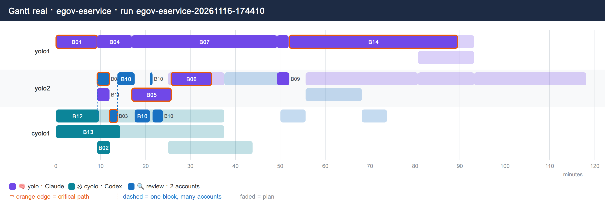
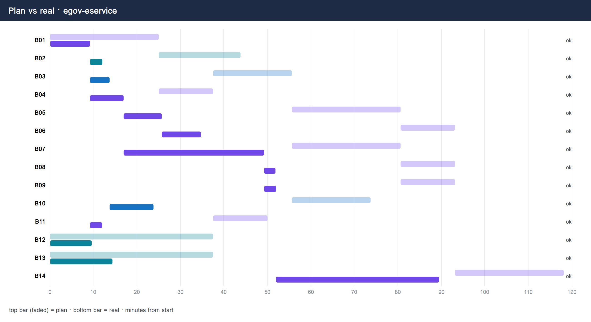

# REPORT · egov-eservice

Run `egov-eservice-20261116-174410` · plan ≈ 118.1 min · real 89.4 min

| block | skill | planned accounts | real accounts | plan min | real min | input tokens | output tokens | status |
| --- | --- | --- | --- | --- | --- | --- | --- | --- |
| B01 | yolo | yolo1 | yolo1 | 25.0 | 9.1 | 3425045 | 51408 | ok |
| B02 | cyolo | cyolo1 | cyolo1 | 18.8 | 2.8 | 328881 | 7425 | ok |
| B03 | review | yolo2, cyolo1 | yolo2, cyolo1 | 18.1 | 4.5 | 992999 | 21515 | ok |
| B04 | yolo | yolo2 | yolo1 | 12.5 | 7.7 | 4528043 | 37681 | ok |
| B05 | yolo | yolo2 | yolo2 | 25.0 | 8.8 | 4797354 | 48000 | ok |
| B06 | yolo | yolo1 | yolo2 | 12.5 | 9.0 | 7165969 | 43732 | ok |
| B07 | yolo | yolo1 | yolo1 | 25.0 | 32.3 | 257813 | 121 | ok |
| B08 | yolo | yolo2 | yolo1 | 12.5 | 2.6 | 1465373 | 12429 | ok |
| B09 | yolo | yolo1 | yolo2 | 12.5 | 2.7 | 1701342 | 11706 | ok |
| B10 | review | yolo2, cyolo1 | yolo2, cyolo1 | 18.1 | 10.1 | 4267782 | 31870 | ok |
| B11 | yolo | yolo1 | yolo2 | 12.5 | 2.8 | 1001349 | 24467 | ok |
| B12 | cyolo | cyolo1 | cyolo1 | 37.5 | 9.5 | 1134682 | 24850 | ok |
| B13 | cyolo | cyolo1 | cyolo1 | 37.5 | 14.3 | 1935676 | 36880 | ok |
| B14 | yolo | yolo2 | yolo1 | 25.0 | 37.5 | 5786585 | 33141 | ok |

**Time factor k (real ÷ plan) saved to `/workspace/plans/calib.json`:** {'yolo': 0.692, 'cyolo': 0.284, 'review': 0.403}

The plan names accounts, but the graph uses sides (`yolo` / `cyolo`) so agent-team can fail over. Planned vs real accounts can differ: that is expected and shown above.
